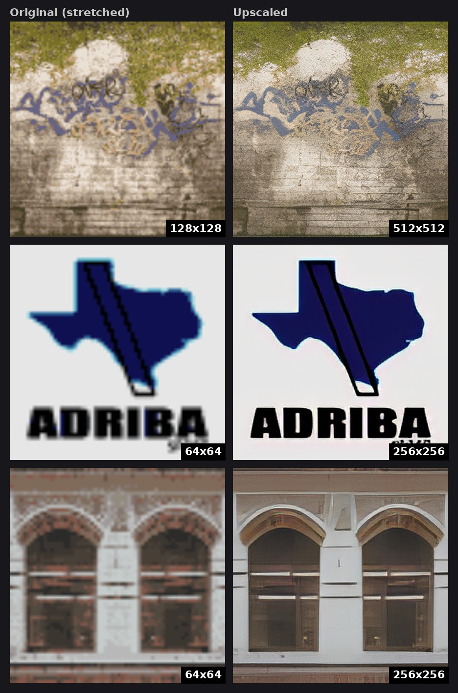

# pcsx2-upscaler

A workflow that upscales a PCSX2 game's dumped textures 4x and writes them as BC7 `.dds` replacements that PCSX2 loads directly. Textures with text use one model and everything else uses another.

**Bring your own model:** no upscaling models are included. You supply any two 4x ONNX upscalers (or the same one twice), and the workflow handles everything around them: sorting textures by text, edge padding, PS2 alpha, tiling on low VRAM, mipmapped `.dds` output, skips and close-up passes. How good the replacements look depends mostly on the models you choose.

```
                                     ┌─ has text ─► text model ──┐
<textures>/<GAME>/dumps/<hash>.png ──┤                           ├─► BC7 .dds + mipmaps ─► <textures>/<GAME>/replacements/<hash>.dds
                                     └─ no text ──► other model ─┘
```



*Made with one particular pair of models. Results vary with the models you use.*

## How it works

- **Only what's missing:** a dump counts as replaced if a file with the same name (any extension) exists anywhere under `replacements/`, including texture-pack subfolders. Downloaded packs are never overwritten, and an interrupted run continues where it stopped.
- **Skip list:** textures named in `<textures>/<GAME>/skip.txt` are never upscaled, and any existing replacement for them under `replacements/` (pack subfolders included) is deleted on each run, so the game shows the original texture.
- **Game plugins:** a game can have a plugin, `plugins/<GAME>.py`, with rules only that game needs, loaded automatically. For now plugins can leave textures unreplaced by inspecting them (see [plugins/README.md](plugins/README.md)). Need for Speed: Underground's skips scratch video memory dumped as textures and car body skins, which the game builds anew for every paint and vinyl combination.
- **Second pass for close-up textures:** if the game has been measured with `texture_usage.py` (see below), textures seen magnified 3.3x or more (see "closest" below) whose 4x replacement is 512 px or smaller are upscaled 4x again, to 16x the dump. The 16x is only kept if it visibly changes the texture at that view (mean luminance change of at least 3/255; flat textures, glows and gradients gain nothing), otherwise the 4x stays and the texture is recorded in `~/.cache/pcsx2-upscaler/usage/<GAME>/boost_rejected.json` with the magnification it was judged at. It's only tried again once seen at least 25% more magnified (`BOOST_RETRY_MAG`), since a closer view can make the 16x worth it. 16x replacements of textures that no longer qualify go back to 4x. Only this script's own replacements are touched, never pack files.

  The thresholds come from a blind A/B test of 50 textures shown at their closest in-game view: below 1.5x magnification 4x and 16x couldn't be told apart, between 1.5x and 3.3x it was a coin toss (and text sometimes looked worse at 16x), and from 3.3x on 16x was preferred 18 times out of 21 and never looked worse. They're `BOOST_MIN_MAG`, `BOOST_MIN_GAIN` and `BOOST_MAX_SIDE` at the top of `pcsx2_upscale.py`.
- **Text detection:** OCR (RapidOCR with PP-OCRv4, Latin and Chinese) runs on each texture first. A texture counts as text when OCR reads at least 2 characters with confidence ≥ 0.5. On 229 hand-labelled dumps this gave 89% precision and 98% recall; the old "detected text area" approach peaked at about 63% / 81%. The rule favours recall because a general-purpose model tends to garble lettering, while a text-oriented model usually handles any texture well. It runs on the GPU at about 75 ms per texture.
- **Edges:** each texture is padded before upscaling. If its opposite edges match (repeating ground and wall textures), it's padded with them, so the upscale tiles without seams. Otherwise (gradients, shadows, UI bars) it's mirrored, so one edge doesn't bleed into the other.
- **PS2 alpha:** transparency runs 0–128 on the PS2 (128 = opaque). It stays within each dump's own range:
  - near-uniform alpha is resized normally;
  - real cut-outs go through the model, then are limited to the dump's range.
- **Low VRAM:** each texture is upscaled whole first. If the GPU runs out of memory, it retries in progressively smaller overlapping tiles.
- **`.dds` output:** BC7 with a full mipmap chain. PCSX2 can't generate mipmaps for compressed textures itself. Encoding runs in background processes while the GPU upscales.

## Setup

```bash
uv venv .venv
uv pip install --python .venv/bin/python -r requirements.txt
```

Put two 4x ONNX upscalers of your choice in `models/` (the file names are set at the top of `pcsx2_upscale.py`). Any 4x single-image super-resolution model exported to ONNX should work; to use one model for everything, put it under both names:

| File | Used for |
|---|---|
| `other.onnx` | everything without text |
| `text.onnx` | textures with text |

The OCR models are downloaded by `rapidocr` on first run.

In PCSX2, under **Settings → Graphics → Texture Replacement**:
- **Dump Replaceable Textures:** turn on and play, to collect dumps.
- **Load Texture Replacements:** turn on to use the results.

## Usage

```bash
.venv/bin/python pcsx2_upscale.py [textures_dir]    # default: ~/.config/PCSX2/textures
```

Pick a game from the list (names come from PCSX2's game list). The script first sorts every dump without a replacement into text and non-text, then upscales each group with its model.

### Leaving textures unreplaced

Create `<textures>/<GAME>/skip.txt` with one texture per line. Each line can be the hash, the file name (any extension) or a full path; `#` starts a comment. Lines with wildcards (`*`, `?`, `[...]`) are patterns matched against the whole name, for families of textures that keep showing up under new hashes:

```
# blurry HUD font, the original looks better
1a5f3316f752e298-2838fc9f5ff51c7c-000059d3
replacements/pack/1a8dd21b75996f4a-8b1fe45826ac4020-00005194.dds
# every texture whose name ends this way
*-0000a1b2
```

On the next run those textures are skipped, and their existing replacements are deleted, including ones from downloaded packs.

`recommended_skips.csv` lists textures worth skipping per game (serial, game, texture, what it is, why). Copy the `texture` column of your game's rows into its `skip.txt` to use them.

## Texture usage (optional)

`texture_usage.py` measures how often the game draws each texture and how close to the camera it gets, so you can see which replacements matter most (or which texture is behind a glitch). It samples frames with [RenderDoc](https://renderdoc.org) while you play: every 20 seconds one frame is captured (a freeze of about half a second), the textures drawn in it are counted, and the capture is deleted.

Setup, once:
1. Download the Linux tarball from [renderdoc.org/builds](https://renderdoc.org/builds) and extract it to `~/Applications/` (or pass `--renderdoc DIR`).
2. Register its Vulkan layer for your user: `~/Applications/renderdoc_<version>/bin/renderdoccmd vulkanlayer --register --user`. It only activates in programs launched through RenderDoc.
3. In PCSX2, set **Settings → Graphics → Renderer** to Vulkan (OpenGL also works).

```bash
.venv/bin/python texture_usage.py [textures_dir] [--pcsx2 PATH] [--interval 20] [--top 30]
```

Pick the game, then play it in the PCSX2 window that opens. Close PCSX2 to finish. Each frame shows up in the terminal as it's counted, and the report at the end lists the most-used textures:

```
in frames  draws/frame  closest  status    texture
     100%        110.7     0.8x  replaced  c4010ca101394499-41db6a081dc88d63-00001dd3
      67%          3.0     3.2x  skipped   8fb42b62ecb75632-59e16594d3d6e113-00001dd3  (+2 identical)
```

A second list follows with the most magnified textures.

- **in frames:** share of sampled frames that used the texture. **draws/frame:** how many times it was drawn in those frames.
- **closest:** the most the texture has been magnified: native PS2 screen pixels per texel of the original dump, at the closest sampled view (2.0x = each texel covered 2x2 pixels). It's measured per triangle from the frame's geometry, on screen only (off-screen passes such as reflection maps don't count); per frame the 95th-percentile triangle is kept, so one odd triangle can't set it, and the highest value across all frames is stored. `usage.json` also accumulates, per texture, the visible screen area it covered in each magnification band (`area_mag`), for weighing how much of the screen a texture really occupies. Multiply by your internal resolution to see on-screen pixels: at 3x, a texel at 2.0x covers 6 pixels, which a 4x replacement can't fill. Sprites that PCSX2 expands on the GPU aren't measured.
- Textures are recognised by content: a replacement by its `.dds` data, a texture without one by its dump. Variants with identical content (same texture, different palette hash) are counted together.
- The upscaler reads these counts to give frequently drawn textures a second pass (see "How it works").
- Counts, and the closest view, add up across sessions in `<textures>/<GAME>/usage.json`. `--reset` starts over, `--report` only prints the report.
- Frames are only captured while the chosen game is running: paused emulation, the BIOS or another game don't count. The script asks PCSX2 through its PINE interface, which it switches on in `PCSX2.ini` (`EnablePINE = true`) if needed.
- PCSX2 runs under X11 (XWayland) for this, since RenderDoc can't capture Wayland windows. An AppImage is extracted once to `~/.cache/pcsx2-upscaler/pcsx2/`, because RenderDoc can't inject into the AppImage launcher.

## Comparison video (optional)

`compare_video.py` turns two captures of the same gameplay, one with original textures and one upscaled, into a comparison video: a title card, then the gameplay with a divider sweeping across (original on the left, upscaled on the right), with the game's audio. It needs `ffmpeg`.

1. In PCSX2, under **Settings → Graphics → Media Capture**, capture at the internal resolution with a high bitrate (around 40,000 kbps), or the upscale is lost in the video.
2. Load a savestate, then **Tools → Input Recording → New...**, start from **Current Frame**, play the part to show and stop the recording.
3. Replay it twice (**Tools → Input Recording → Play...**) with **Tools → Video Capture** running: once with **Load Texture Replacements** off, once on (with **Precache Texture Replacements** on, so nothing pops in late). Each capture can start and stop whenever is convenient.
4. Run:

```bash
.venv/bin/python compare_video.py [original.mp4 upscaled.mp4] [--out FILE] [--title TEXT]
```

Without arguments it takes the two newest captures in `~/.config/PCSX2/videos/` and works out which one is upscaled (the sharper one). It lines them up by their audio, so they can start a few frames apart, and stops if the replays drifted apart. The video is written next to the captures as `<game>_comparison.mp4`.

## Files

| File | Purpose |
|---|---|
| `pcsx2_upscale.py` | The whole flow: game selection, upscaling, writing replacements |
| `textdet.py` | Text detection (OCR), decides which model a texture goes to |
| `dds.py` | BC7 `.dds` writer with mipmaps, in the layout PCSX2's loader expects |
| `texture_usage.py` | Texture usage sampling: indexes the textures, runs the session, prints the report |
| `usage_agent.py` | Runs inside RenderDoc: launches PCSX2, captures frames, counts textures per frame |
| `compare_video.py` | Comparison video from two captures of the same input recording |
| `plugins/` | Per-game rules (see [plugins/README.md](plugins/README.md)) |
| `recommended_skips.csv` | Textures worth skipping, per game |
